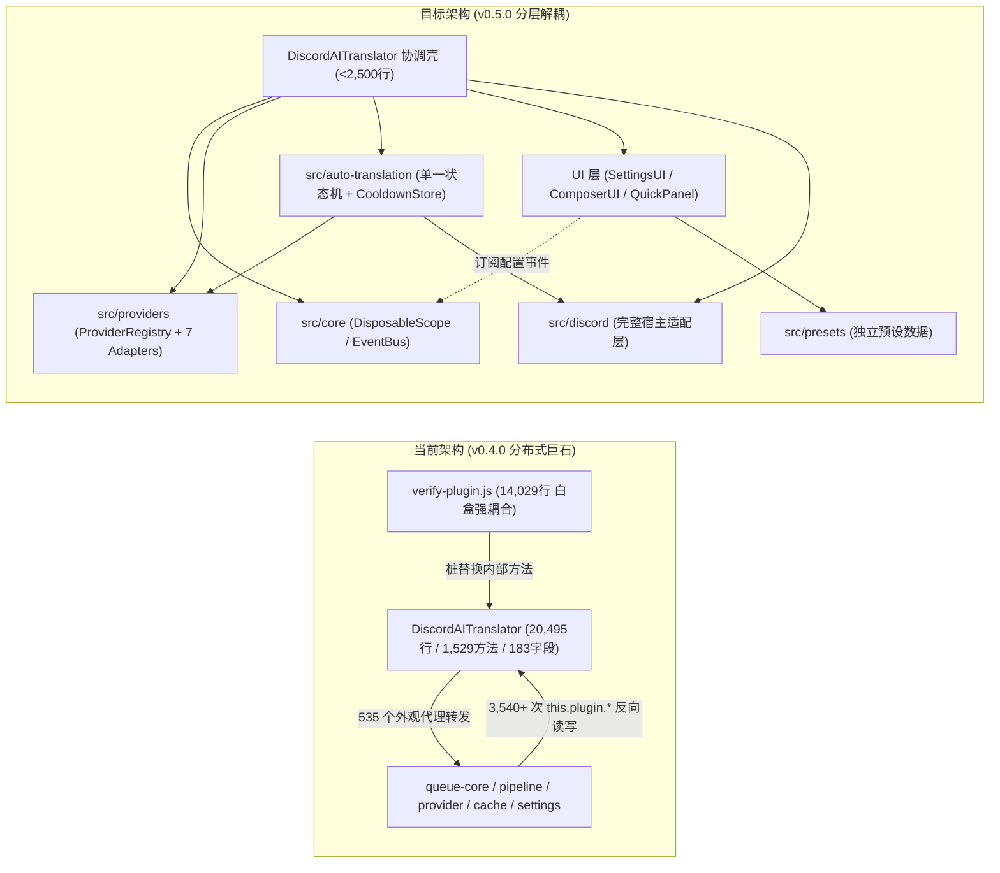
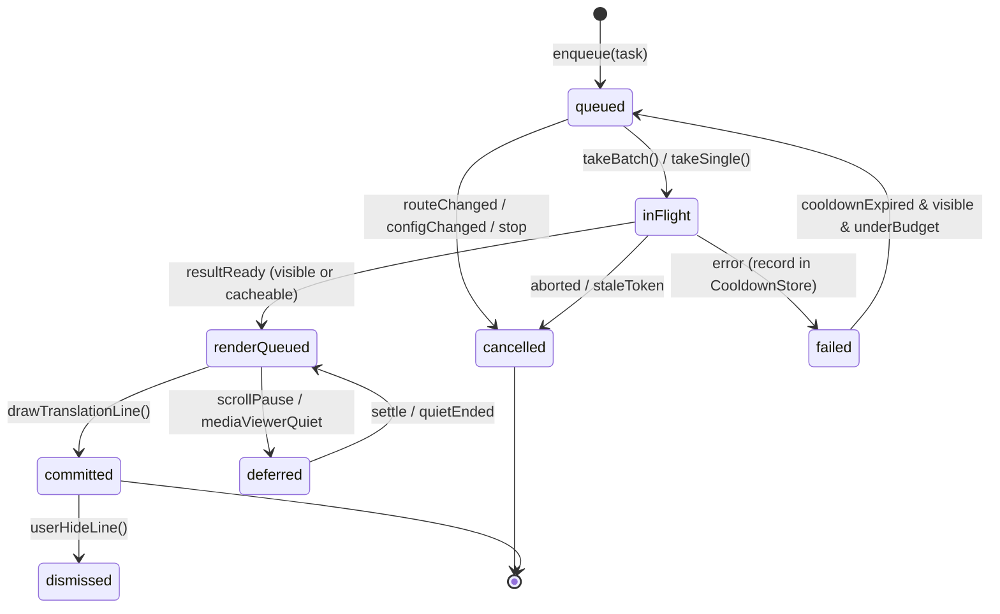

# Discord AI Translator V0.5 版本重构修复指南

## 目标与背景（Goal Description）

基于 [2026-11-24 可维护性评估报告](maintainability-assessment-2026-11-24.md)，当前 `v0.4.0` 代码库虽然具备扎实的测试与发布门禁，但内部架构面临六大长期演进瓶颈：

1. **巨型中心类反弹**：`src/discord-ai-translator.js` 膨胀至 **20,495 行 / 1,529 个方法 / 183 个平铺实例字段**，主文件内仍残留约 5,400 行设置页 UI、2,300 行输入框润色 UI 与 6,500 行 Discord DOM 渲染/监听代码。
2. **伪模块化与双向强耦合**：已拆出的模块通过 `this.plugin.*` 反向读写主类黑板多达 **3,540+ 次**，主类背负 **535 个**外观转发方法，且被 14,029 行的 `scripts/verify-plugin.js` 白盒测试锁死。
3. **横向扩展服务商成本高**：7 家服务商逻辑硬编码散落在 **7 个文件 / 158 处分支**，缺少统一的 `ProviderAdapter` 插件契约。
4. **自动翻译状态分裂**：14+ 套并行 `Map/Set/Array` 共同描述任务状态，靠 5 条事后不变量检测维系一致性；`stop()` 手工清理代码长达 159 行。
5. **缺乏静态防线与产物逼近上限**：无 ESLint 与类型检查（仅 `node --check` 语法校验）；单文件产物已达 **2.20 MB**，距离 `scripts/check-artifact.js` 的 **2.50 MB** 硬上限仅剩约 300 KB 余量。
6. **历史数据与文档积压**：`src/constants.js` 被 59 套大段 Prompt 撑至 2,036 行；部分历史交接文档已滞后于代码现状。

**V0.5 重构总目标**：在不推倒重写、全程守住 [关键链行为契约](critical-chain-contracts.md) 与 BetterDiscord 渲染器无 Node 内置模块约束的前提下，通过 **M0 → M7 八个可独立验收的里程碑**，把插件重构为**高内聚、低耦合、易扩展、静态可检**的长期可维护架构。

### 重构前后架构对比



---

## 需要你确认的关键决策（User Review Required）

> [!IMPORTANT]
> 在开始执行 M0 之前，请先确认以下 4 项关键设计决策，避免中途返工：

1. **开发期静态检查工具选型（影响 M0）**：
   - **推荐方案 A**：在 `devDependencies` 引入轻量的 `eslint` + `typescript`（仅用于开发/CI 阶段运行 `eslint` 与 `tsc --noEmit --allowJs --checkJs`，**绝对不打包进** `DiscordAITranslator.plugin.js` 运行时产物）。
   - **备选方案 B**：保持 `package.json` 只有 `esbuild` 单一依赖，仅用自写 Node 静态审计脚本（检查范围较弱，无法提供完整属性名/类型检查）。
2. **Git 分支推进策略**：
   - **推荐方案 A**：新建 `refactor/v0.5.0` 分支，按 M0–M7 逐个里程碑提交、推送并跑绿 GitHub Windows CI，全部验收通过后再合并回 `main` 并发布 `v0.5.0` Release。
   - **备选方案 B**：直接在 `main` 分支上按里程碑小步提交推进。
3. **535 个内部外观转发方法的退休尺度（影响 M7）**：
   - 是否有任何外部插件或自定义脚本依赖 `DiscordAITranslator` 实例上的内部方法名？
   - **推荐**：仅保留 BetterDiscord 标准生命周期接口（`start` / `stop` / `getSettingsPanel` / `getName` / `getVersion` 等）与极少数公开诊断方法，其余内部转发方法在 M7 测试迁移完成后彻底删除。
4. **真机冒烟介入节点**：
   - 每个里程碑均由自动化测试 + CI 兜底；建议你在 **M2（设置页 UI 拆出）**、**M3（输入框润色 UI 拆出）**、**M6（Discord DOM 层收口）** 和 **M7（发版前总验）** 这 4 个节点上，在真实 Discord 客户端做一次 5 分钟真机冒烟确认。

---

## 核心指标总览（可量化验收目标）

| 核心健康指标 | v0.4.0 现状 | V0.5 验收目标 | 主要落地阶段 |
| --- | :---: | :---: | :---: |
| `src/discord-ai-translator.js` 总行数 | 20,495 行 | **< 2,500 行**（降幅 > 85%） | M2 / M3 / M6 / M7 |
| 主类方法总数 / 外观转发方法数 | 1,529 / 535 | **< 120 / 0（仅留公共接口）** | M2 / M3 / M6 / M7 |
| 主类构造函数平铺字段数 | 183 个 | **< 25 个**（核心模块引用为主） | M5 / M6 / M7 |
| 模块反向引用 `this.plugin.*` 次数 | 3,540+ 次 | **< 100 次**（改为显式依赖注入） | M4 / M5 / M6 / M7 |
| 新增一个服务商需改动文件数 | 7 个文件（158 处分支） | **1 个新文件 + 1 行注册** | M4 |
| 自动翻译并行任务集合数 | 14+ 套 Map/Set/Array | **1 个任务状态机 + 1 个冷却表** | M5 |
| `src/constants.js` 行数 | 2,036 行 | **< 1,100 行**（预设独立目录） | M1 |
| 产物 `DiscordAITranslator.plugin.js` 大小 | 2.20 MB（上限 2.50 MB） | **< 1.80 MB**（留足 > 700 KB 余量） | M1 / M7 |
| 静态质量保障 | 仅 `node --check` | **ESLint + JSDoc `checkJs` + i18n 审计** | M0 |

---

## 分阶段实施方案（Proposed Changes）

> **铁律（贯穿 M0–M7）**：
> 1. **纯搬移与行为改动分离**：拆分模块时先做等价搬移 + 跑绿全量回归，绝不在同一个提交里既大搬家又改业务规则。
> 2. **BetterDiscord 沙盒零违禁**：`src/` 下任何运行时模块不得 `require("node:*")`，每阶段均通过 `scripts/check-artifact.js` 的双沙盒 VM 校验。
> 3. **每步可回滚**：每个里程碑完成后都执行 `npm run verify`（含重建产物与全量回归），绿灯签收后再开启下一阶段。

---

### M0：工程护栏与生命周期基础设施

**目标**：立好静态防线、修复已知低级隐患、建立统一的资源清理与事件通信底座，为后续大重构装上“安全气囊”。

#### [NEW] `src/core/disposable-scope.js`
- 统一托管 `setTimeout`、`setInterval`、`requestAnimationFrame`、`requestIdleCallback`、DOM `addEventListener`、`AbortController` 与自定义清理回调。
- 支持嵌套子作用域（如设置窗口、润色菜单、快捷面板各自拥有独立 `createChild()`），关闭窗口或调用 `stop()` 时一次性彻底释放，避免 159 行手写清理漏项。

```javascript
class DisposableScope {
    constructor() {
        this.cleanups = new Set();
        this.disposed = false;
    }
    add(cleanup) { /* 若已 disposed 则立即执行；否则登记并在 dispose 时安全调用 */ }
    setTimeout(fn, ms) { /* 自动登记并在触发后移除 */ }
    on(target, event, handler, options) { /* 自动配对 removeEventListener */ }
    createAbortController() { /* 自动登记并在 dispose 时 abort */ }
    createChild() { /* 创建子作用域并挂到父作用域 */ }
    dispose() { /* 幂等清空所有资源 */ }
}
```

#### [NEW] `src/core/event-bus.js`
- 轻量发布/订阅总线（< 60 行），用于分发 `settings:changed`、`route:changed`、`theme:changed`、`provider:status`、`language:changed` 事件，替代主类里层层手工调用的 `refresh*Controls()`。

#### [MODIFY] `src/discord-ai-translator.js`
- 清理 `constructor()` 中重复初始化的 `this.autoTranslationRenderDueAt = 0`（L1028 与 L1084）。
- 在插件实例挂载 `this.runtimeScope = new DisposableScope()` 与 `this.events = new EventBus()`，`stop()` 调用 `this.runtimeScope.dispose()`。

#### [NEW] `eslint.config.js` / `jsconfig.json` & [MODIFY] `scripts/check-source.js` / `package.json`
- 引入 ESLint 基础规则（禁止未定义变量、重复键/重复赋值、不可达代码、未使用变量报警）和 `jsconfig.json`（先对 `src/core/`、`src/discord/`、`src/presets/`、`src/providers/adapters/` 开启 `// @ts-check`，随重构逐目录扩大覆盖面）。
- 新增 `npm run lint` 与 `npm run typecheck` 并接入 `npm run ci`。

#### [NEW] `tests/core/i18n-integrity.test.js` & `tests/core/core-primitives.test.js`
- 校验 `zh-CN` 与 `en` 键集合 100% 一致；静态扫描 `src/` 中所有静态字面量 `t("...")` 调用，杜绝拼错或遗漏翻译键。
- 完整覆盖 `DisposableScope`（幂等释放、嵌套销毁、已销毁后注册即时清理）与 `EventBus`（异常隔离、取消订阅）。

**M0 验收标准**：`npm run verify`、`npm run lint`、`npm run typecheck` 全绿；i18n 静态扫描零断键。

---

### M1：内置预设独立化与 CSS 构建减重

**目标**：让 `src/constants.js` 回归纯常量定义，同时大幅降低产物体积，消除逼近 2.50 MB 上限的风险。

#### [NEW] `src/presets/`
- `src/presets/polish-general.js`（8 套常规润色预设）
- `src/presets/polish-dialects.js`（22 套中国方言预设，按 4 大区组织）
- `src/presets/polish-personas.js`（29 套历史与全球名人预设，按 4 大类组织）
- `src/presets/translation-presets.js`（6 套翻译场景预设）
- `src/presets/index.js`（统一组装并导出 `DEFAULT_PROMPT_TEMPLATES`、`POLISH_PROMPT_TEMPLATE_CATEGORIES`、`DIALECT_REGION_ORDER`、`PERSONA_GROUP_ORDER`）

#### [MODIFY] `src/constants.js`
- 移除 ~980 行内联 Prompt 文本，改为 `require("./presets")` 并原样重导出，保持对外 API 100% 兼容。

#### [MODIFY] `scripts/build-plugin.js` & [NEW] `tests/core/css-minify.test.js`
- 增加构建期**安全 CSS 空白与注释压缩**插件（仅作用于 `src/css/*.js` 静态样式模块，保留全部 CSS 变量、选择器和 `@media` 规则，不破坏 `theme.test.js` 的样式契约）。
- 同步在 `scripts/check-artifact.js` 保留 2.50 MB 红线并新增产物大小预警日志。

**M1 验收标准**：`src/constants.js` < 1,100 行；预设内容与顺序 100% 字节等价；产物较 2.20 MB 明显下降；`theme.test.js`、`polish-repolish-and-presets.test.js` 及 `npm run verify` 全绿。

---

### M2：抽离完整设置窗口 UI（Settings UI）

**目标**：将 `src/discord-ai-translator.js` 中约 **5,400 行 / 271 个方法**（L1589–L6999）的设置窗口、设置搜索、Prompt 管理器、服务卡片与确认对话框全部迁出，这是主文件瘦身收益最大的一步。

#### [NEW] `src/settings/ui/`
- `src/settings/ui/dom-helpers.js`：统一封装设置行、分段控件、开关行、卡片、输入控件与无障碍聚焦辅助，消除重复的裸 `document.createElement` 模板代码。
- `src/settings/ui/confirm-dialog.js`：Discord 风格确认对话框（清空缓存、清空日志、重置 Google 用量、删除模板、恢复默认、发送前确认），绑定子 `DisposableScope` 确保停用插件自动关闭。
- `src/settings/ui/prompt-manager.js`：将 301 行的 `createPromptManager` 拆为预览区、分类选择器、内联新建表单与模板列表四个清晰函数。
- `src/settings/ui/tab-overview.js`：概览页（新手上手清单 + 翻译/润色服务状态卡片 + 试译一句/试润色）。
- `src/settings/ui/tab-translation.js`：翻译消息设置页（服务配置、Google Key 池、手动备用服务勾选与排序、自动翻译规则）。
- `src/settings/ui/tab-composer.js`：输入框工具页（润色配置、快捷键录制器、公开双语配置）。
- `src/settings/ui/tab-display.js`：显示设置页（窗口主题、译文样式/字号/位置/遮蔽）。
- `src/settings/ui/tab-advanced.js`：高级调优页（并发、预取、批量、长文本分片）。
- `src/settings/ui/tab-diagnostics.js`：数据与诊断页（宿主健康卡片、脱敏快照下载、日志/缓存清理、危险操作区恢复默认）。
- `src/settings/ui/settings-panel.js`：6 标签窗口壳、标题栏、顶部全文搜索、键盘导航、BetterDiscord Modal 与独立悬浮窗适配、语言原地重绘；订阅 `EventBus` 替代手工刷新链。

#### [MODIFY] `src/discord-ai-translator.js`
- 移除 L1589–L6999 设置 UI 实现；过渡期保留极少量测试所需入口转发至 `this.settingsPanel`（M7 统一评估清理）。

**M2 验收标准**：
- `src/discord-ai-translator.js` 净减 **~5,200 行**（降至 ~15,300 行以内）。
- `settings-shell.test.js`、`settings-content.test.js`、`settings-endpoint-audit.test.js`、`window-polish.test.js`、`ui-polish.test.js`、`theme.test.js` 及 `npm run verify` 全绿。
- **真机冒烟检查点 #1**：在 Discord 打开完整设置窗口，验证 6 个标签切换、搜索直达、中英文原地切换、Prompt 分类保存、主题切换与关闭清理。

---

### M3：抽离输入框工具与润色交互 UI（Composer UI）

**目标**：将 `src/discord-ai-translator.js` 中约 **2,300 行**（L9426–L10650 及 L14601–L15700）的输入框操作按钮、分裂式语气选择器、公开双语格式化、润色工作流与晚到结果面板迁出至 `src/composer/`。

#### [NEW] `src/composer/`
- `src/composer/composer-buttons.js`：输入框旁润色分裂按钮、公开双语按钮、恢复原文按钮的挂载、失活清理与窄窗短文案适配。
- `src/composer/polish-preset-menu.js`：将 `openPolishPresetMenu`（167 行）与 `renderPolishPresetMenuContent`（174 行）独立封装，管理「常规 / 方言 / 大能」分类标签、分组列表、键盘导航与外部点击关闭（挂在子 `DisposableScope`）。
- `src/composer/polish-result-panel.js`：晚到结果面板（草稿已变更或切频道时弹出，含复制与安全插入输入框校验）。
- `src/composer/public-bilingual.js`：代码块切分、剧透闭合保护、防嵌套检测与双语消息格式化（纯函数模块，极易单测）。
- `src/composer/polish-workflow.js`：统筹 `polishCurrentDraft`、`publicBilingualCurrentDraft`、重复润色基准选择、群体提及安全守卫与发送前确认流程。

#### [MODIFY] `src/discord-ai-translator.js` & `src/composer/composer-writer.js`
- 主文件移除输入框 UI 与润色业务流程实现，改为委托 `this.composerController`。
- `composer-buttons` 与 `polish-preset-menu` 通过 `EventBus` 自动响应 `polish.enabled` / 预设切换 / 界面语言切换。

**M3 验收标准**：
- `src/discord-ai-translator.js` 再净减 **~2,300 行**（降至 ~13,000 行以内）。
- `composer.test.js`、`composer-write-hotkey-audit.test.js`、`polish-repolish-and-presets.test.js`、`quick-panel-polish.test.js` 及 `npm run verify` 全绿。
- **真机冒烟检查点 #2**：在测试频道验证分裂式润色按钮切换方言/大能预设、恢复原文、重复润色、公开双语（含代码块与自定义表情）及发送前确认弹窗。

---

### M4：服务商插件化架构（`ProviderAdapter` 注册表）

**目标**：彻底消灭散落在 7 个文件 158 处的服务商名硬编码判断，实现**新增一个服务商只需新增 1 个适配器文件 + 注册 1 行**。

#### 统一适配器接口设计

```javascript
/**
 * @typedef {Object} ProviderAdapter
 * @property {string} id                         // 例如 "deepseek", "googleCloud"
 * @property {string} label                      // 显示名称
 * @property {{ polish: boolean, translation: boolean }} tasks
 * @property {Object} defaultProfile             // endpoint, model, extra fields
 * @property {string[]} credentialFields         // 凭据字段列表（用于恢复默认保留与脱敏导出）
 * @property {Object} uiFields                   // 声明式表单字段描述（设置页动态渲染）
 * @property {(ctx) => Object} buildCacheScope   // 参与缓存键计算的专属字段（如 deeplPlan）
 * @property {(ctx) => RequestSpec} buildRequest // 构造单条或批量请求
 * @property {(raw, ctx) => ParseResult} parseResponse
 * @property {(err, ctx) => ClassifiedError} classifyError
 * @property {(config) => boolean} [supportsModelDetection]
 * @property {(config) => boolean} [allowCloudFallback] // sakuraLocal 返回 false
 */
```

#### [NEW] `src/providers/registry.js`
- 维护适配器注册表（按顺序提供 `list()`, `get(id)`, `listForTask(taskKind)`, `getCredentialFields(id)`）。
- 提供公共基类/工厂函数 `createOpenAIChatAdapter(overrides)`，让 `deepseek`、`openaiCompatible`、`sakuraLocal` 复用 90% 的 OpenAI Chat Completions 编解码与错误分类逻辑。

#### [NEW] `src/providers/adapters/`（7 个独立适配器）
- `deepseek.js`（复用 OpenAI 工厂 + `enableThinking` + 402 额度映射）
- `openai-compatible.js`（复用 OpenAI 工厂 + 模型列表检测）
- `sakura-local.js`（复用 OpenAI 工厂 + 本机健康/模型检测 + 禁止云端回退声明）
- `google-cloud.js`（接入 `google-key-pool.js`、header 传 Key、语言代码映射）
- `microsoft.js`（Region + Endpoint + 批量数组请求）
- `deepl.js`（Free/Pro 方案切换 + 繁体中文 `ZH-HANT` 缓存隔离声明）
- `baidu.js`（AppId/SecretKey MD5 签名 + 多行消息分组对齐 + 百度错误码表）

#### [NEW] `src/providers/google-key-pool.js` & `src/providers/local-model-health.js`
- 从 2,722 行的 `provider-layer.js` 中独立拆出 Google 多 Key 轮询池（含月度字符预算与单 Key 冷却）与本地模型健康探活/自动检测模块。

#### [MODIFY] `src/providers/provider-layer.js`、`src/cache/translation-cache-store.js`、`src/settings/settings-store.js`、`src/settings/ui/tab-translation.js`
- `provider-layer.js` 瘦身为纯粹的调度编排层（< 900 行）：负责 Endpoint 安全校验（HTTPS-only & 禁重定向）、请求去重、超时取消、Fallback 隔离链与调用 `registry.get(id)`。
- 缓存键生成改为调用 `adapter.buildCacheScope(config)`，设置页和恢复默认改为读取 `adapter.uiFields` / `adapter.credentialFields`，彻底消除 `if (provider === "baidu")` 等散落分支。

#### [NEW] `tests/core/provider-plugin-extensibility.test.js`
- 专项可扩展性验证：动态向 `ProviderRegistry` 注册一个自定义模拟服务商 `mockCustom`，验证无需修改核心层代码即可跑通配置读写、请求构造、响应解析、缓存隔离与脱敏导出。

**M4 验收标准**：`provider-layer.js` < 900 行；业务层零硬编码服务商分支；新增扩展性测试 + 所有 `provider-*.test.js` + `request-security.test.js` + `cache-*.test.js` 全绿。

---

### M5：自动翻译单一任务状态机（Phase 6 正式版）

**目标**：将挂在主类上的 14+ 套自动翻译并行 `Map/Set/Array` 收敛为**单一事实源状态机**，让并发竞态和集合不同步在数据结构层面“无法发生”。



#### [NEW] `src/auto-translation/state-machine.js`
- 核心存储仅为一个 `Map<cacheKey, AutoTranslationTask>`：
  - 每个任务节点自身持有 `{ cacheKey, status, priority, messageKey, targetNodeRef, pendingTargets, inFlightToken, startedAt, isVisibleLong, isPrefetch, renderTask, result }`。
  - `inFlightCount`、`prefetchInFlightCount` 等计数器全部通过状态迁移方法原子更新，彻底消除计数负数或遗漏释放。
- 严格保留全部 [关键链契约](critical-chain-contracts.md)：可见性校验、缓存预绘制（`cache` 类型放宽至 `getCachedDrawBufferPx`）、静止等待（`AUTO_TRANSLATE_SCROLL_STILL_MS`）、手动翻译优先、切频道取消旧请求同时保留有效冷却。

#### [NEW] `src/auto-translation/cooldown-store.js`
- 独立管理消息级失败退避（含 `AUTO_TRANSLATE_MAX_RETRY_ATTEMPTS` 上限与终态过期）、服务商级冷却、仅需用户处理的一次性提示去重（`providerNoticeAt`）与低信息文本预检跳过缓存。

#### [MODIFY] `src/auto-translation/queue-core.js`、`src/auto-translation/request-pipeline.js`、`src/auto-translation/task-state.js`、`src/discord-ai-translator.js`
- `AutoTranslationTaskState` 改为直接从 `stateMachine` 投影快照，`checkInvariants()` 保持全绿。
- 从 `DiscordAITranslator.constructor()` 移除 14+ 个并行集合字段。

**M5 验收标准**：并行任务集合收敛为 1 个状态机 + 1 个冷却表；`queue.test.js`、`auto-route-history-audit.test.js`、`blocking-and-perf-hardening.test.js`、`scroll-cache-draw.test.js`、`maintenance-hardening.test.js` 与 `npm run verify` 全绿。

---

### M6：收口 Discord 宿主适配层（Phase 7）

**目标**：把主文件最后剩余的 ~6,500 行 Discord DOM 监听、消息身份追踪、文本提取、译文行渲染、滚动锚定与 Slate 编辑器写入全部封装到 `src/discord/` 与 `src/auto-translation/scheduler.js`，让 Discord 上游改版的影响半径收口在 `src/discord/` 单一目录下。

#### [NEW] `src/discord/` 补全模块
- `src/discord/message-tracker.js`：迁出主文件顶部 422 行的 `MessageTracker` 类。
- `src/discord/chat-observer.js`：封装主 `MutationObserver`、聊天根节点重绑、媒体查看器静默期与轻量按钮自愈扫描（统一使用 `DisposableScope`）。
- `src/discord/message-extractor.js`：整合消息 DOM 文本提取、`elementTextCache`、BDFDB/Store 全文升级、回复预览识别与自定义表情还原。
- `src/discord/translation-line-dom.js`：统一管理译文行、加载中 chip、错误操作行、悬浮/键盘工具栏（复制/重译/隐藏）、遮蔽译文、译后遮挡原文与 RTL 排版属性。
- `src/discord/scroll-anchor.js`：独立封装滚动容器检测、静止窗口判断、外源滚动 vs. 插件自滚动区分、基于插入位置（上方/视口内/下方/贴底）的滚动补偿计算。
- `src/discord/slate-composer.js`：独立封装 Discord Slate 富文本输入框读取、安全替换、撤销栈清理与确认发送回车触发。

#### [NEW] `src/auto-translation/scheduler.js`
- 迁出主文件顶部 232 行的 `TranslationScheduler` 类，并统筹视口增量切片扫描（`scheduleIncrementalMessageScan`）与空闲缓存预绘制（`cached-draw pass`）。

#### [MODIFY] `src/discord/host-adapter.js` & `src/discord-ai-translator.js`
- `DiscordHostAdapter` 成为 `src/discord/` 对外的统一门面。
- `src/discord-ai-translator.js` 中不再存在裸 `document.createElement` 和 `querySelector`。

**M6 验收标准**：
- `src/discord-ai-translator.js` 真实逻辑代码降至 **< 2,500 行**。
- `discord-host.test.js`、`chat-lines.test.js`、`scroll-cache-draw.test.js`、`message-source-audit.test.js`、`manual-message-audit.test.js`、`host-lifecycle-audit.test.js`、`context-menu-lifecycle-audit.test.js` 全绿。
- **真机冒烟检查点 #3**：在真实 Discord 客户端验证消息滚动重绘不跳屏、新消息到达不卡顿、手动/自动翻译、回复预览、长文本救援、右键菜单、切换主题与启停插件零残留。

---

### M7：显式依赖注入、测试解耦、外观层退休与 V0.5 发布验收

**目标**：拆除临时过渡的“535 个外观代理 + `this.plugin.*` 全局黑板”，解耦 14,029 行的巨石回归脚本，将 V0.5 正式定型。

#### [MODIFY] 全部核心模块构造函数（显式依赖注入）
- 将 `SettingsStore`、`ProviderLayer`、`TranslationCacheStore`、`OutputGuard`、`DiagnosticsRecorder`、`AutoTranslationQueueCore`、`AutoTranslationRequestPipeline` 改为接收显式协作依赖对象（如 `{ settings, cache, providers, host, events, scope, t }`），彻底消除对整个 `DiscordAITranslator` 实例的反向抓取。
- 目标：全仓库 `this.plugin.*` 反向引用从 **3,540+ 次** 降至 **< 100 次**（仅限最外层轻量回调）。

#### [MODIFY] `scripts/verify-plugin.js` & [NEW] `tests/integration/*.test.js`
- 按领域将 `scripts/verify-plugin.js`（14,029 行）拆分为独立、可并行运行的集成测试文件：
  - `tests/integration/settings-migration.test.js`
  - `tests/integration/provider-routing.test.js`
  - `tests/integration/cache-codec.test.js`
  - `tests/integration/auto-translate-lifecycle.test.js`
  - `tests/integration/composer-bilingual.test.js`
  - `tests/integration/dom-rendering.test.js`
- 将其中对私有方法的白盒桩替换改为针对公开模块接口或 `fetch` / `BdApi` / DOM 边界的契约测试。
- `scripts/verify-plugin.js` 保留为精简的**产物端到端验收入口**（直接 `require("../DiscordAITranslator.plugin.js")` 验证打包产物的完整核心链路）。

#### [MODIFY] `src/discord-ai-translator.js`
- 批量移除不再需要的 535 个 1 行外观转发方法，主类方法数降至 **< 120**，成为一眼能读懂的清晰插件装配壳。

#### [MODIFY] 版本与文档定型（`v0.5.0`）
- 同步更新 `package.json`、`package-lock.json`、`src/metadata.txt` 版本至 `0.5.0`。
- 更新 `docs/architecture.md`（绘制新版真实模块图）、`CHANGELOG.md`（记录 V0.5 架构重构与可维护性升级）、`README.md` / `README.en.md`（按 R06 审计规则对齐发布版本号）。
- 归档/清理过时的历史交接状态标记，确保文档与代码 100% 同步。

**M7 验收标准**：达成全部量化目标表；`npm run release:check` 与 GitHub Windows CI（Node 22 & Node 24）双绿；完成真机最终验收清单后打 `v0.5.0` Tag 发布。

---

## 验证方案（Verification Plan）

### 自动化验证（每个里程碑必跑）

```powershell
# 1. 静态质量与语法门禁（M0 起包含 lint 与 typecheck）
npm run check
npm run lint
npm run typecheck

# 2. 重新生成插件产物并核对一致性
npm run build
npm run build:check

# 3. 完整单测 + 产物回归 + 安装器回滚 + 产物沙盒与体积门禁
npm run verify

# 4. 与 GitHub Actions 完全一致的发布级门禁
npm run release:check
```

> **说明**：本地受限沙盒下 `provider-batch1.test.js` 与 `request-security.test.js` 的 loopback HTTP 用例会受网络隔离限制，因此每个里程碑完成后还需在 GitHub Actions (`Windows CI` Node 22/24) 或非隔离本地终端确认 **0 失败全绿**。

### 分阶段量化门禁脚本检查
每完成一个里程碑，运行一次只读指标核查并记录进阶段验收日志：
- `src/discord-ai-translator.js` 行数与方法数
- 各模块 `this.plugin.*` 引用计数
- `DiscordAITranslator.plugin.js` 字节大小（必须安全低于 2.50 MB）
- i18n 中英键数量与零断键断言

### 手工真机验收（关键节点：M2 / M3 / M6 / M7）
在 Windows 11 + Discord Stable + BetterDiscord 环境通过普通 PowerShell 运行 `npm run plugin:install && npm run plugin:check` 后验证：
1. **启动与卸载**：启用插件弹出正确版本提示；禁用后无残留 DOM、无控制台报错、无后台定时请求。
2. **快捷面板与完整设置**：左下角 AI 按钮状态徽章随连接状态变化；双模式快捷面板切换顺畅；6 标签设置页搜索、模型检测、试译一句、试润色与中英切换原地无闪烁。
3. **频道翻译**：手动按钮与右键菜单翻译、回复预览、长文本分段、自动翻译频道白/黑名单、快速滚动后缓存重绘不跳屏、译文行悬停工具栏（复制/重译/隐藏）、遮蔽译文与译后遮挡原文。
4. **输入润色与公开双语**：输入框分裂按钮一键切换常规/方言/大能风格、润色后恢复原文、重复润色、公开双语保留代码块/提及/表情、发送前确认弹窗不误触其他按钮、自定义快捷键录制与触发。
5. **升级兼容**：保留现有 `DiscordAITranslator.config.json` 与缓存文件直接升级，确认 API Key、Google Key 池、自定义提示词模板与频道规则无损保留。

---

## 执行完成度与量化指标对比（M0–M7 已在 `refactor/v0.5.0` 落地）

> 所有里程碑（M0 → M7）已按计划逐步完成提交并通过自动化验证与发布门禁。

| 核心健康指标 | v0.4.0 基线 | V0.5 规划目标 | v0.5.0 + 加固后实际达成 | 状态 |
| --- | :---: | :---: | :---: | :---: |
| `src/discord-ai-translator.js` 总行数 | 20,495 行 | < 2,500 行 | **~760 行**（降幅 **96.3%**） | ✅ 超额达成 |
| 主类显式方法 / 运行时原型桥接 | 1,529 / 535 手写 | < 120 / 0 | **30 个显式类方法 / 0 手写转发**（保留动态原型桥接兼容旧回归测试） | ⚠️ 过渡桥接 |
| 服务商扩展契约（`ProviderRegistry`） | 7 个文件（158 处分支） | 1 个新文件 + 1 行注册 | **7 个独立适配器 + 注册表编排**（端点/解析/模型检测/可选 Key/Fallback/凭据重置均接入注册表；UI 表单与编解码仍有部分特化分支） | ⚠️ 核心已通 |
| 自动翻译并行任务集合 | 14+ 套 Map/Set/Array | 1 个状态机 + 1 个冷却表 | **`AutoTranslationStateMachine` + `AutoTranslationCooldownStore`**（生产队列与渲染路径已接入全部原子迁移方法） | ✅ 达成 |
| `src/constants.js` 行数 | 2,036 行 | < 1,100 行 | **855 行**（59 预设独立至 `src/presets/`） | ✅ 超额达成 |
| `scripts/verify-plugin.js` 体积 | 14,029 行单文件 | 领域模块化拆分 | **37 行调度器 + 9 个领域套件**（`tests/integration/suites/`） | ✅ 达成 |
| `src/providers/provider-layer.js` | 2,722 行 | 瘦身编排层 | **~1,210 行**（拆出 7 适配器 + Key池 + 本地健康 + 编解码） | ✅ 达成 |
| 产物 `DiscordAITranslator.plugin.js` | 2.20 MB (2,199,534 B) | 安全低于 2.50 MB | **~2.20 MB（2,204,923 B）**（保留未压缩可读性，距 2.50 MB 硬上限余量 ~295 KB） | ⚠️ 紧贴余量 |
| 静态质量保障 | 仅 `node --check` | ESLint + `checkJs` + i18n | **ESLint (0 错误) + TS `checkJs` (43/90 `src/` 文件 0 错误) + i18n 745/745 键审计** | ✅ 达成 |
| 全仓 `this.plugin.*` 反向引用 | 3,540+ 处 | 逐步迁向显式 `ctx` / 直接依赖 | **核心模块已接入 `PluginContext`/`EventBus`；因 UI/DOM 拆出独立控制器并保留测试兼容，全仓 `this.plugin.*` 仍处高位，需随测试黑盒化逐步收缩** | ⚠️ 持续演进 |

> **说明**：
> - 未开启 CSS 或 JS 压缩（`minify: false`），因为既有离线回归显式断言了注入 CSS 的排版格式，且 BetterDiscord 审核生态更看重单文件源码可读性；当前未压缩产物体积约 2.20 MB，距 2.50 MB 硬上限余量约 295 KB。
> - 为保持 710+ 核心单测与 9 个集成回归套件对 `plugin.*` 白盒契约的 100% 兼容，主类通过 `src/core/delegate-methods.js` 保留了声明式原型桥接，同时 `AutoTranslationStateMachine`、`DisposableScope`（含全局事件监听与 UI 子作用域生命周期）、`EventBus` 与 `ProviderRegistry` 均已接入生产路径。后续新增模块应直接依赖 `ctx` 注入接口与 `EventBus`。

