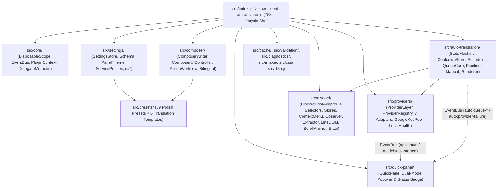

# Architecture (v0.5.2)

## Distribution Model

BetterDiscord users install a single generated file: `DiscordAITranslator.plugin.js`. Contributors edit files under `src/`, and `npm run build` bundles `src/index.js` via esbuild into the root artifact. The bundle stays unminified for BetterDiscord security review, preserves the BetterDiscord metadata block at byte 0, exports the plugin class via CommonJS, and executes cleanly inside Electron's renderer sandbox with **zero `node:*` imports**.

## Module Map (`src/`)

- **`src/discord-ai-translator.js`** (~760 lines, 30 explicit class methods): Thin BetterDiscord plugin lifecycle shell (`start`, `stop`, `flushPendingPersistence`, `t`/`getLocale`, `formatError`, `injectStyles`/`removeStyles`, domain event subscriptions, and declarative prototype/state bridges preserving legacy white-box test contracts).
- **`src/core/`** (all `// @ts-check`):
  - `disposable-scope.js` (`DisposableScope`): Unified resource cleanup for timers, RAF/idle callbacks, DOM listeners, AbortControllers, and child scopes (`start()` wires global listeners and reset-focus timers onto `runtimeScope`; UI controllers resolve live child scopes across `start()`/`stop()` cycles).
  - `event-bus.js` (`EventBus`): Isolated synchronous pub/sub bus connecting `ProviderLayer`, `AutoTranslationQueueCore`, lifecycle transitions, settings changes, and `QuickPanel`.
  - `plugin-context.js` (`createPluginContext`): Explicit lazy dependency context passed to domain modules.
  - `delegate-methods.js`: Declarative `installPrototypeBridge`, `installClassPrototypeBridge`, `attachControllerMethods`, and `installStateProxies` utilities (retaining compatibility bridge methods on `DiscordAITranslator.prototype` while source remains cleanly modularized).
- **`src/presets/`** (all `// @ts-check`): Independent data modules (`categories.js`, `polish-general.js`, `polish-dialects.js`, `polish-personas.js`, `translation-presets.js`, `index.js`) extracted out of `src/constants.js`.
- **`src/settings/`**:
  - `settings-store.js` (`SettingsStore`): Persistence, legacy split-store migration, schema enforcement, task config resolution, prompt-template CRUD, and registry-aware credential carry-over on reset.
  - `settings-schema.js` (`SettingsSchema`, `checkJs`) & `panel-theme.js` (`PanelTheme`) & `service-profiles.js` (`ServiceProfilesController`).
  - `ui/` (11 focused modules): `settings-shell.js`, `settings-search.js`, `settings-sizing.js`, `tab-overview.js`, `tab-services.js`, `tab-sections.js`, `prompt-manager.js`, `settings-controls.js`, `settings-modal.js`, `confirm-dialog.js`, `index.js`.
- **`src/providers/`**:
  - `registry.js` (`ProviderRegistry`, `createOpenAIChatAdapter`) & `adapters/` (7 pluggable adapters: `deepseek`, `openai-compatible`, `sakura-local`, `google-cloud`, `microsoft`, `deepl`, `baidu` — all `// @ts-check`). `byParser` tracks ordered adapter sets per parser and `fetchModelResponse` prefers the request's own provider adapter when compatible.
  - `provider-layer.js` (`ProviderLayer`): Endpoint security policy (HTTPS-only remote, zero HTTP redirects), request deduplication, timeouts, fallback isolation (`allowCloudFallback: false` / local providers never fall back to cloud), and adapter orchestration (`getEffectiveEndpoint`, `buildRequest`, `buildTestRequest`, `buildHeaders`, `hasUsableConfig`, `parseResponse`, `applyCacheScope`).
  - `google-key-pool.js`, `local-model-health.js`, `provider-codecs.js`: Focused provider helpers.
- **`src/auto-translation/`**:
  - `state-machine.js` (`AutoTranslationStateMachine`, `// @ts-check`) & `cooldown-store.js` (`AutoTranslationCooldownStore`, `// @ts-check`): Unified single source of truth for active task state, queues, in-flight counters, render queues, failure backoffs, and provider cooldowns — driven via atomic transitions (`enqueue`, `removeQueued`, `markInFlightItem`, `beginInFlightBatch`, `finishInFlightItem`, `finishInFlightBatch`, `enqueueRenderTask`, `clearRenderQueue`) from `queue-core.js` and `scroll-anchor.js`.
  - `task-state.js` (`AutoTranslationTaskState`, `checkJs`): Read-only snapshot & invariant checker backed directly by `AutoTranslationStateMachine` and `AutoTranslationCooldownStore`.
  - `scheduler.js` (`TranslationScheduler`), `queue-core.js`, `request-pipeline.js`, `manual-translation.js`, `translation-renderer.js` (`checkJs`), `channel-rule.js` (`checkJs`).
- **`src/composer/`**: `composer-writer.js` (`checkJs`) plus 6 UI/workflow modules (`composer-buttons.js`, `polish-preset-menu.js`, `polish-result-panel.js`, `public-bilingual.js`, `polish-workflow.js`, `index.js`).
- **`src/discord/`** (all checked via `jsconfig.json`): Unified behind `DiscordHostAdapter` (`host-adapter.js`):
  - `selectors.js`, `stores.js`, `context-menu.js`, `host-health.js`, `message-tracker.js`, `chat-observer.js`, `launcher-and-theme.js`, `message-extractor.js`, `scroll-anchor.js`, `translation-line-dom.js`, `slate-composer.js`.
  - Isolates upstream Discord DOM / Webpack / Slate changes inside one directory.
- **Support domains**:
  - `src/cache/translation-cache-store.js`: Cache keys (delegating provider scope via `adapter.applyCacheScope`), aliases, TTL, compact persistence codec.
  - `src/validation/{output-guard,prompt-policy}.js`: Output integrity checks & prompt/mention protection rules.
  - `src/diagnostics/{diagnostics-recorder,diagnostic-labels}.js`: Redacted diagnostics recording and export.
  - `src/quick-panel/quick-panel.js`: Bottom-left AI launcher badge and dual-mode quick popover.
  - `src/intake/{discord-markup,emoji-text}.js`, `src/ui/host-health-card.js`, `src/css/*`, `src/i18n.js`, `src/constants.js`.

## Verification & Quality Guardrails

- **Static checks**: `npm run check` (`node --check` + version sync across `package.json`, `package-lock.json`, `src/metadata.txt`), `npm run lint` (ESLint across `src/`, `scripts/`, `tests/`), `npm run typecheck` (`tsc -p jsconfig.json --noEmit` covering 43 of 90 `src/` JS modules across `src/core/`, `src/presets/`, `src/providers/adapters/`, `src/discord/`, and pure state/schema/intake helpers), and `tests/core/i18n-integrity.test.js` (0 missing/orphaned i18n keys).
- **Automated tests**:
  - `npm run test:core`: Focused unit & audit suites under `tests/core/` (including `provider-plugin-extensibility.test.js`, `auto-state-machine.test.js`, `core-primitives.test.js`, `presets-and-css-build.test.js`).
  - `npm run test:plugin` / `npm run test:integration`: Runs 9 modular domain regression suites (`tests/integration/suites/01-*.js` through `09-*.js`) directly against the built `DiscordAITranslator.plugin.js` artifact via the slim `scripts/verify-plugin.js` runner.
  - `npm run test:installer` & `npm run artifact:check`: BetterDiscord Windows installer rollback tests + BetterDiscord renderer sandbox load & size check (< 2.50 MB).
  - `npm run release:check`: Full Windows CI release gate (MIT license, secret/private-path scan, Git index checks, and full `npm run ci`).
